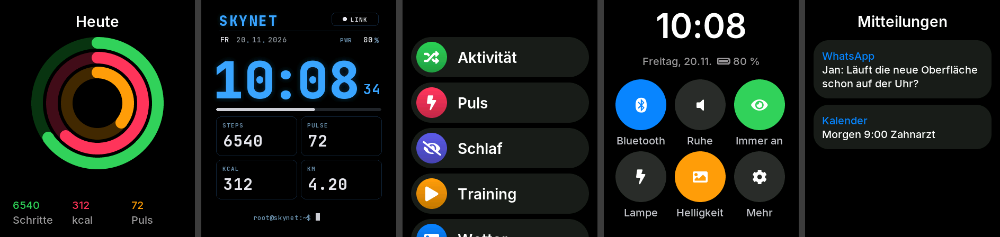

# openWatchOS firmware parts

Parts of the future own firmware for the M78. They are built and tested on the PC now; nothing here is flashed
to the watch yet. The goal: look and function similar to the stock firmware, compatible with its watch faces,
with own watch faces, LVGL 9.6 as the interface library and the JS app engine – but rounder and better overall.

*Preview from the host simulator (activity, watch face, apps, control centre, notifications).*

| Part | Folder | Status |
| --- | --- | --- |
| Watch face engine | `owf/` | Draws stock watch face files (`JL` format) in bands of the screen, without allocation. Same pixels as our reference renderer for all test faces, hands included. |
| Interface | `ui/` | LVGL 9.6 (newest release; the SDK ships 8.3, its LVGL port is small and gets rewritten for 9): watch face, apps, control centre, activity, notifications, swipe navigation like the stock firmware. First draft. |
| Fonts | `ui/fonts/` | Inter with umlauts and the LVGL symbols, sizes 20, 28 and 64 (licence: `FONTS-LICENSE.txt`). |
| Host simulator | `sim/` | Runs the interface with the watch's display settings (RGB565 high byte first, draw buffer of 40 rows) and writes each page as a picture. |

Not yet here: the hardware layer (display, touch, keys) for the SDK build, the JS engine on LVGL, settings,
apps behind the list entries.

## Build and try

    git clone --depth 1 --branch v9.6.0 https://github.com/lvgl/lvgl.git ../lvgl
    make -C fw/sim LVGL=$PWD/../lvgl
    fw/sim/sim FACE.di out/          # out/activity.ppm, face.ppm, apps.ppm, control.ppm, notes.ppm

    gcc -O2 -o owf_cli fw/owf/owf.c fw/owf/owf_cli.c
    ./owf_cli FACE.di face.ppm hour=23 minute=59 battery=5

## How the watch face reaches LVGL

The face is an LVGL image whose decoder is the engine: LVGL asks for the rows it is drawing, the decoder renders
bands of 40 full-width rows with `owf_render`. There is no screen-sized buffer, so a face costs one band of RAM,
and the stock faces work unchanged. The face in the simulator is pixel-identical to `owf_cli`.
